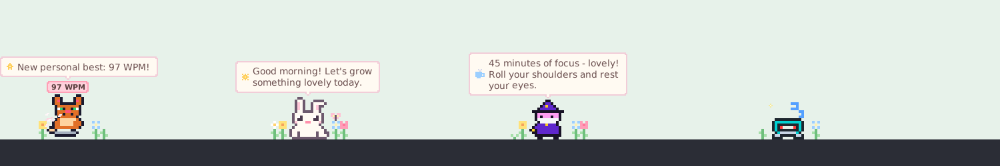

# 🌸 Taskbar Typing Companion — spring edition

A tiny pixel friend that stands on your **Windows taskbar** (or perches on the window you're
using). It types along with you, grows a little garden out of your keystrokes, gets visits from
butterflies, says something kind now and then, and curls up for a nap when you stop.



---

## 🚀 Quick start

Double-click **`run.bat`**, or run:

```bash
pythonw companion.py      # no console window
python companion.py       # with a console (handy for troubleshooting)
```

Needs **Windows 10/11** and **Python 3.8+** (tkinter comes with the python.org installer).
Nothing else to install.

Curious what it can do? `run.bat --demo` cycles through typing, turbo, resting and napping in
about half a minute (and grows the garden 25× faster). Demo typing is never saved to your stats.

---

## ✨ What it does

### 🎭 Four companions


| | |
|---|---|
| 🐱 **Mini Cat** | Wags its tail, taps a mini keyboard, curls into an orange ball to sleep. |
| 🤖 **Mini Robot** | Blinking antenna, visor that powers down for a blink, dim-LED sleep mode. |
| 🧙 **Mini Wizard** | Star hat and beard, casts typing spells with a crystal wand, naps on the grimoire. |
| 🐰 **Mini Bunny** *(new)* | Twitchy ears, rosy cheeks, a mint keyboard, and a bunny-loaf nap. |

### 🌷 A garden that grows while you type
Every **1,000 keystrokes** grows a flower beside your companion - sprout, stem, bud, bloom - up
to four a day (tulips, daisies, bluebells and buttercups, a different mix each day). A fresh
garden is planted every morning and it **never wilts**: nothing to lose, no streaks, no guilt.

### 🦋 Little visitors
While you rest, a **butterfly** drops by now and then and settles on a flower or on your
companion's head. At nap time, soft **fireflies** glow around it.

### 💬 Kind words (never pushy)
Soft speech bubbles for a few special moments: a hello that fits the time of day, your **first
flower** and a **full garden**, a **new personal best**, "welcome back" after a long nap, and a
happy reply when you pet it. Low-priority chatter never interrupts anything important, and
**Friendly Messages** in the menu switches it all off.

### 🍵 Stretch reminders
After a long stretch of typing (45 minutes by default; 30/60/90 or off in the menu) it suggests
a little break - stretch, sip some water, rest your eyes. A real pause of 5 minutes resets the
clock, and it never asks twice in a row.

### ⌨️ Types along with you
- Paws, arms and wands swap **on every keystroke**.
- A soft **WPM badge** above the head turns blossom-pink in **turbo mode** (60+ WPM), when
  petals puff up from the keyboard.
- Holding a key (auto-repeat) and tapping Shift/Ctrl/Alt don't inflate your WPM.

### 📍 Three ways to sit (right-click → *Positioning Mode*)
- **📌 Dock to Taskbar** *(default)* - feet exactly on the taskbar line. Drag it sideways to slide
  along; pull it up to float freely, drop it back on the taskbar to dock again.
- **🪟 Perch on Active Window** - glides to the title bar of the window you're using, clear of the
  minimise/maximise/close buttons.
- **🪶 Free Floating** - anywhere you like; it always stays on a visible monitor.

### 🧰 Comfortable to live with
- **Doesn't steal focus:** clicking or dragging it leaves your cursor where you were typing.
- **Stays on top,** even after you click the taskbar, and **steps aside during fullscreen**
  games, videos and presentations.
- **Light on your PC:** it rests at a gentle 10 fps and used well under 1% of one CPU core while
  resting in testing.
- **Remembers everything:** companion, size, position and every option.
- **Start with Windows** toggle, crisp on high-DPI screens, one copy at a time.

---

## 🎮 Controls

| Action | Result |
|---|---|
| **Click** | Pet it ❤️ (sometimes it answers) |
| **Double-click** | Today's journal: keys typed, best WPM, flowers in bloom |
| **Drag** | Move it (slides along the taskbar while docked) |
| **Click a bubble** | Dismiss it |
| **Right-click** | The menu: companion, positioning, size, journal, garden & visitors, friendly messages, stretch reminders, WPM badge, hide during fullscreen, start with Windows, snap to taskbar, nap / wake up, quit |

---

## 🔒 Privacy

Only the **timing** of key presses is used. *Which* key you press is never stored, logged or sent
anywhere - there is no network code at all. The only files written are these (in
`%APPDATA%\TypingCompanion\`):

| File | Contents |
|---|---|
| `settings.json` | Your choices. Safe to edit or delete. |
| `stats.json` | Keys today, lifetime keys, best WPM - counters only. |
| `companion.log` | Start-up and error messages (small, self-rotating). |

---

## 🛠️ Troubleshooting

| Problem | Try |
|---|---|
| Nothing appears | A message box explains start-up problems. Otherwise check `companion.log`, or run `python companion.py` in a terminal to see errors. Deleting `settings.json` resets the position. |
| It's somewhere odd / off a monitor | Right-click → **Snap to Taskbar**. |
| It doesn't react to typing | Look for `keyboard backend:` in `companion.log`. Keystrokes typed into an elevated (admin) window may not be visible to a normal app. |
| Too chatty | Right-click → untick **Friendly Messages**, and/or **Stretch Reminders → Off**. |
| "Already running" box | Only one copy runs at a time - look near your taskbar clock. |
| `run.bat` says Python isn't found | Install Python from python.org and tick **Add python.exe to PATH**. |

**Keyboard watching:** by default the companion polls the keyboard about 50 times a second. That
needs nothing installed and stays out of Windows' input path, so it can never slow down your
typing. `python companion.py --hook` uses a low-level hook instead (`pip install pynput`); if
the hook keeps crashing, the companion quietly switches back to polling.

---

## 👩‍💻 Development

```
companion.py        the window: main loop, rendering, mouse, menu, housekeeping
bubble.py           the speech-bubble window + pixel-art canvas helpers
core.py             typing meter (WPM, mood), settings and stats storage
garden.py           the daily garden: which flowers, how grown
cozy.py             greetings, pet replies, journal, the stretch-reminder coach
effects.py          petals, hearts, sparkles, fireflies, butterflies (motion only)
sprites.py          all pixel art: companions, flowers, effect shapes, bubble icons
theme.py            spring colours and fonts for the UI
keyboard_input.py   keyboard polling + optional pynput hook
winutil.py          every Windows API call, each safe to call on any OS
tests/              unittest suite
tools/make_preview.py   regenerates docs/preview.png (needs Pillow)
```

Only `companion.py` and `bubble.py` touch tkinter, and only `winutil.py` touches Windows APIs;
everything else is plain Python and is tested directly.

Run the tests from this folder:

```bash
python -m unittest discover -s . -t .
```

The window tests need a display; on a headless Linux box use
`xvfb-run -a python3 -m unittest discover -s . -t .` (with `python3-tk` and `xvfb` installed).
They skip themselves when tkinter or a display isn't available. The Windows-only code is covered
by tests that substitute fake DLLs, but only a real Windows machine can confirm things like
transparency, focus behaviour and DPI scaling.

**Adding a companion:** draw 16×16 frames in `sprites.py` (`sit_a`, `sit_b`, `blink`, `type_l`,
`type_r`, `sleep_a`, `sleep_b`), register them with `_character(...)`, and add a few pet replies
in `cozy.py`. The tests check sizes, palette indices and that the feet touch the ground. Frames
are ground-aligned automatically. Watch out for `[[_] * 16 for _ in range(n)]` - the loop
variable rebinds `_` (the "transparent" alias); use `[[0] * 16 for _row in range(n)]`.
