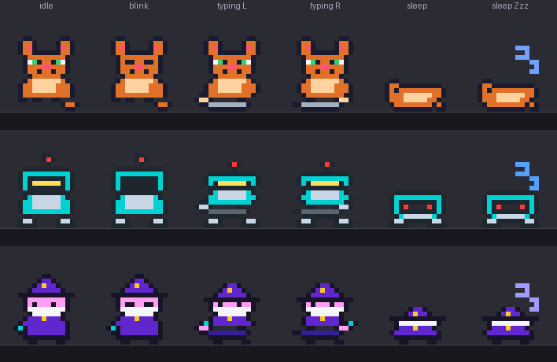

# 🐾 Taskbar Typing Companion

A tiny, borderless pixel sprite that stands on your **Windows taskbar** (or perches on the
window you're working in). It reacts to every keystroke, speeds up as your typing does,
celebrates new personal bests, and curls up to sleep when you stop.



---

## 🚀 Quick start

Double-click **`run.bat`**, or run:

```bash
pythonw companion.py      # no console window
python companion.py       # with a console (handy for troubleshooting)
```

Requirements: **Windows 10/11** and **Python 3.8+** (tkinter ships with the python.org installer).
Nothing else needs installing. Optionally `pip install pynput` for a low-level keyboard hook; if
it's missing the companion falls back to polling the keyboard and works the same.

Want to see everything without typing? `run.bat --demo` cycles through idle, slow, brisk, turbo
and nap.

---

## ✨ Features

### 🎭 Three companions
| | |
|---|---|
| 🐱 **Mini Cat** | Blinks, wags its tail, taps a mini keyboard with alternating paws, curls up with a drifting `Zzz`. |
| 🤖 **Mini Robot** | Blinking antenna LED, visor that powers down for a blink, dual typing arms, dim-LED sleep mode. |
| 🧙 **Mini Wizard** | Star hat and beard, strikes the grimoire with a glowing wand, slumps over the book to sleep. |

### ⌨️ Reacts to how you type
- Paws, arms and wands swap **on every keystroke**, not on a timer.
- **WPM badge** above the head (smoothed, and accurate from the first seconds of a burst).
- **Turbo mode** at 60+ WPM: the badge turns gold and sparkles fly.
- **New personal best:** confetti and a `NEW BEST` banner (once per typing run).
- **Sleeping:** after 35 s idle it dozes off; any key wakes it instantly with a startled hop.
- Holding a key (auto-repeat) and tapping Shift/Ctrl/Alt do **not** inflate your WPM.

### 📍 Three positioning modes (right-click → *Positioning Mode*)
- **📌 Dock to Taskbar** *(default)* - feet exactly on the taskbar line. Drag it **sideways** to slide
  along the taskbar. Pull it up off the taskbar to switch to free floating; drop it back on
  the taskbar and it docks again.
- **🪟 Perch on Active Window** - glides to the title bar of whatever window you're using,
  clear of the minimise/maximise/close buttons. Ignores the taskbar, desktop and menus.
- **🪶 Free Floating** - put it anywhere. It always stays on a visible monitor.

### 🧰 Quality of life
- **Click to pet** it - hearts!
- **Doesn't steal focus:** clicking or dragging the sprite leaves your cursor in the app you were
  typing in.
- **Stays on top,** even after you click the taskbar, and **steps aside during fullscreen** games,
  videos and presentations.
- **Remembers everything:** character, size, mode, position and the options below.
- **Stats** in the right-click menu: keys today and best WPM.
- **Start with Windows** toggle, crisp on high-DPI displays, one copy at a time.

---

## 🎮 Controls

| Action | Result |
|---|---|
| **Click** | Pet it ❤️ |
| **Drag** | Move it (slides along the taskbar while docked) |
| **Double-click** | Show / hide the WPM badge |
| **Right-click** | Menu: character, positioning, size (48-96 px), WPM badge, hide-during-fullscreen, start with Windows, snap to taskbar, take a nap / wake up, quit |

---

## 🔒 Privacy

Only the **timing** of key presses is used. *Which* key you press is never stored, logged or sent
anywhere - there is no network code at all. The only files written are the three below, and
`stats.json` holds nothing but counters.

| File (`%APPDATA%\TypingCompanion\`) | Contents |
|---|---|
| `settings.json` | Your choices (character, size, mode, position, toggles). Safe to edit or delete. |
| `stats.json` | Keys today, lifetime keys, best WPM. |
| `companion.log` | Start-up and error messages (small, self-rotating). |

---

## 🛠️ Troubleshooting

| Problem | Try |
|---|---|
| Nothing appears | Check `companion.log`, then run `python companion.py` in a terminal to see any errors. Deleting `settings.json` resets the position. |
| Sprite is somewhere odd / off a monitor | Right-click → **Snap to Taskbar**. |
| It doesn't react to typing | Look for `keyboard backend:` in `companion.log`. Some security tools block global keyboard hooks; the polling fallback needs no hook. Windows doesn't pass keystrokes typed into an elevated (admin) window to a normal app. |
| "Already running" box | Only one copy runs at a time - look near your taskbar clock. |
| `run.bat` says Python isn't found | Install Python from python.org and tick **Add python.exe to PATH**. |

---

## 👩‍💻 Development

```
companion.py        window, animation loop, menu, mouse handling
core.py             typing meter (WPM, mood), settings and stats storage - no GUI, no Windows APIs
sprites.py          pixel art, palettes and frame helpers
keyboard_input.py   pynput backend + dependency-free polling backend
winutil.py          every Windows API call, each safe to call on any OS
tests/              unittest suite
tools/make_preview.py   regenerates docs/preview.png (needs Pillow)
```

Run the tests from this folder:

```bash
python -m unittest discover -s . -t .
```

The window tests need a display; on a headless Linux box use `xvfb-run -a python3 -m unittest discover -s . -t .`
(and `apt install python3-tk xvfb`). They skip themselves when tkinter or a display isn't available.
The Windows-only code is covered by tests that substitute fake DLLs, but only a real Windows
machine can confirm things like transparency, focus behaviour and DPI scaling.

**Adding a character:** draw 16×16 frames in `sprites.py` (`sit_a`, `sit_b`, `blink`, `type_l`,
`type_r`, `sleep_a`, `sleep_b`), register them with `_character(...)` and the test suite will check
sizes, palette indices and that the feet touch the ground line. Frames are auto-aligned to the
ground, so don't worry about leaving empty rows at the bottom.
